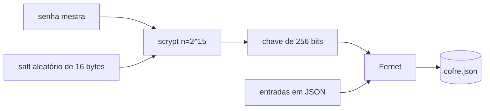

<p align="center"><sub>Cofre de Senhas</sub></p>

---

<p align="center">
  
</p>

<p align="center">
  Gerenciador de senhas no terminal com scrypt e criptografia autenticada (Fernet)
</p>

<p align="center">
  
  
  <a href="https://github.com/arthurlynow098/cofre-de-senhas/actions/workflows/testes.yml"></a>
  
</p>

## Sobre o projeto

Eu sempre recomendava gerenciador de senha para todo mundo, mas não sabia explicar **por que** era seguro guardar tudo num lugar só. Então construí um.

O Cofre de Senhas roda no terminal e guarda tudo em um único arquivo JSON criptografado. A senha mestra nunca é salva em lugar nenhum. Sem ela o arquivo é só um monte de bytes aleatórios, e se alguém alterar um único caractere o cofre percebe e se recusa a abrir.

## Como funciona



## Tecnologias

<p>
  
  
  
</p>

## Executando o código

```bash
git clone https://github.com/arthurlynow098/cofre-de-senhas.git
cd cofre-de-senhas
pip install cryptography

python -m cofre criar
python -m cofre add github --usuario arthurlynow098 --gerar 24
python -m cofre add banco --usuario arthur
python -m cofre listar
python -m cofre ver github
python -m cofre auditar
python -m cofre gerar 32
```

O arquivo fica em `~/.cofre.json`. Dá para mudar com `--arquivo` ou com a variável `COFRE_ARQUIVO`.

Testes

```bash
pip install -r requirements-dev.txt
python -m pytest -q
```

Os testes conferem, entre outras coisas, que nenhum nome ou senha aparece em texto puro no arquivo e que alterar um único caractere faz o cofre recusar a abertura.

## Exemplo

É assim que o arquivo fica no disco depois de salvar uma entrada. Repare que nem o nome "github" aparece.

```json
{
  "versao": 1,
  "kdf": {
    "nome": "scrypt",
    "n": 32768,
    "r": 8,
    "p": 1,
    "salt": "0elR2N4vj06tJEeedxXBqQ=="
  },
  "dados": "gAAAAABq-YjadYQFSlZbZ1Q4zJ2SI4bqhAv0-kbt--32rSXJk3Gx5Z6g5a2uxHYOj8W8..."
}
```

## Estudei por aqui

Segui essas aulas e materiais para entender e aplicar tudo que está aqui.

| Material | O que tirei dele |
|---|---|
| [Documentação do Fernet](https://cryptography.io/en/latest/fernet/) | Como usar e o que tem dentro de um token |
| [cryptography, Key Derivation Functions](https://cryptography.io/en/latest/hazmat/primitives/key-derivation-functions/) | Parâmetros do scrypt |
| [OWASP Cryptographic Storage Cheat Sheet](https://cheatsheetseries.owasp.org/cheatsheets/Cryptographic_Storage_Cheat_Sheet.html) | Boas práticas de guardar dado sensível |
| [TryHackMe, Introduction to Cryptography](https://tryhackme.com/room/cryptographyintro) | Simétrica, assimétrica, hash e onde cada uma entra |

## Licença

Distribuído sob a licença MIT. Veja o arquivo [LICENSE](LICENSE).

<p align="center"><sub>A gravura do banner é o pangolim de Thomas Hardwicke, do século XIX, em domínio público no <a href="https://commons.wikimedia.org/wiki/File%3APangolin_Hardwicke_%28white_background%29.jpg">Wikimedia Commons</a>.</sub></p>
