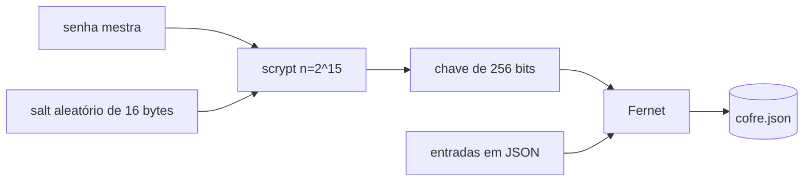

<a id="top"></a>

<p align="center"></p>

<p align="center">


<a href="https://github.com/arthurlynow098/cofre-de-senhas/actions/workflows/testes.yml"></a>

</p>

<p align="center"><a href="#sobre">Sobre</a> &nbsp;&nbsp; <a href="#como-funciona">Como funciona</a> &nbsp;&nbsp; <a href="#rodando">Rodando</a> &nbsp;&nbsp; <a href="#aprendi">O que aprendi</a> &nbsp;&nbsp; <a href="#estudos">Estudos</a></p>

> [!NOTE]
> Projeto de estudo. Para guardar as suas senhas de verdade use um gerenciador auditado, como Bitwarden ou KeePassXC. A graça aqui é entender o que eles fazem por dentro.

<a id="sobre"></a>

<p></p>

Eu sempre recomendava gerenciador de senha para todo mundo, mas não sabia explicar **por que** era seguro guardar tudo num lugar só. Então construí um.

O Cofre de Senhas roda no terminal e guarda tudo em um único arquivo JSON criptografado. A senha mestra nunca é salva em lugar nenhum. Sem ela o arquivo é só um monte de bytes aleatórios, e se alguém alterar um único caractere o cofre percebe e se recusa a abrir.

<a id="como-funciona"></a>

<p></p>



| Peça | Por que está aí |
|---|---|
| **scrypt** | Transforma a senha mestra em chave. É lento e gasta memória de propósito, então testar milhões de senhas mestras fica caríssimo |
| **salt aleatório** | Dois cofres com a mesma senha mestra geram chaves diferentes |
| **Fernet** | Criptografia autenticada da biblioteca `cryptography`. Usa AES no modo CBC com HMAC-SHA256, então além de esconder os dados ele detecta adulteração |
| **escrita atômica** | Salvo num arquivo temporário e depois troco. Se a energia cair no meio, o cofre antigo continua inteiro |
| **`secrets`** | Gerador de senha com fonte de aleatoriedade criptográfica, não o `random` |
| **auditoria** | O comando `auditar` mostra onde você está repetindo a mesma senha |

Uma coisa que eu achei importante deixar clara no próprio programa é que **não existe recuperação**. Se existisse um jeito de abrir sem a senha mestra, um atacante também poderia usar.

<a id="rodando"></a>

<p></p>

```bash
git clone https://github.com/arthurlynow098/cofre-de-senhas.git
cd cofre-de-senhas
pip install cryptography

python -m cofre criar
python -m cofre add github --usuario arthurlynow098 --gerar 24
python -m cofre add banco --usuario arthur
python -m cofre listar
python -m cofre ver github
python -m cofre auditar
python -m cofre gerar 32
```

O arquivo fica em `~/.cofre.json`. Dá para mudar com `--arquivo` ou com a variável `COFRE_ARQUIVO`.

Testes

```bash
pip install -r requirements-dev.txt
python -m pytest -q
```

Os testes conferem, entre outras coisas, que nenhum nome ou senha aparece em texto puro no arquivo e que alterar um único caractere faz o cofre recusar a abertura.

<p></p>

É assim que o arquivo fica no disco depois de salvar uma entrada. Repare que nem o nome "github" aparece.

```json
{
  "versao": 1,
  "kdf": {
    "nome": "scrypt",
    "n": 32768,
    "r": 8,
    "p": 1,
    "salt": "0elR2N4vj06tJEeedxXBqQ=="
  },
  "dados": "gAAAAABq-YjadYQFSlZbZ1Q4zJ2SI4bqhAv0-kbt--32rSXJk3Gx5Z6g5a2uxHYOj8W8..."
}
```

<a id="aprendi"></a>

<p></p>

- A diferença entre derivar uma chave (KDF) e simplesmente fazer hash da senha
- O que é criptografia autenticada e por que só criptografar não basta
- Usar a biblioteca `cryptography` sem cair na tentação de inventar o próprio algoritmo
- Escrita atômica de arquivo com `replace`
- Ajustar o custo do scrypt nos testes para eles continuarem rápidos

Próximos passos

- [ ] Copiar a senha para a área de transferência e limpar depois de 20 segundos
- [ ] Trocar a senha mestra recriptografando tudo
- [ ] Migrar para Argon2id e AES-GCM e comparar

<a id="estudos"></a>

<p></p>

Segui essas aulas e materiais para entender e aplicar tudo que está aqui.

| Material | O que tirei dele |
|---|---|
| [Documentação do Fernet](https://cryptography.io/en/latest/fernet/) | Como usar e o que tem dentro de um token |
| [cryptography, Key Derivation Functions](https://cryptography.io/en/latest/hazmat/primitives/key-derivation-functions/) | Parâmetros do scrypt |
| [OWASP Cryptographic Storage Cheat Sheet](https://cheatsheetseries.owasp.org/cheatsheets/Cryptographic_Storage_Cheat_Sheet.html) | Boas práticas de guardar dado sensível |
| [TryHackMe, Introduction to Cryptography](https://tryhackme.com/room/cryptographyintro) | Simétrica, assimétrica, hash e onde cada uma entra |

<p align="center"><sub>Parte do <a href="https://github.com/arthurlynow098">Lince Lab</a>, minha coleção de projetos de cibersegurança</sub></p>

<p align="center"><a href="#top">Voltar ao topo</a></p>
